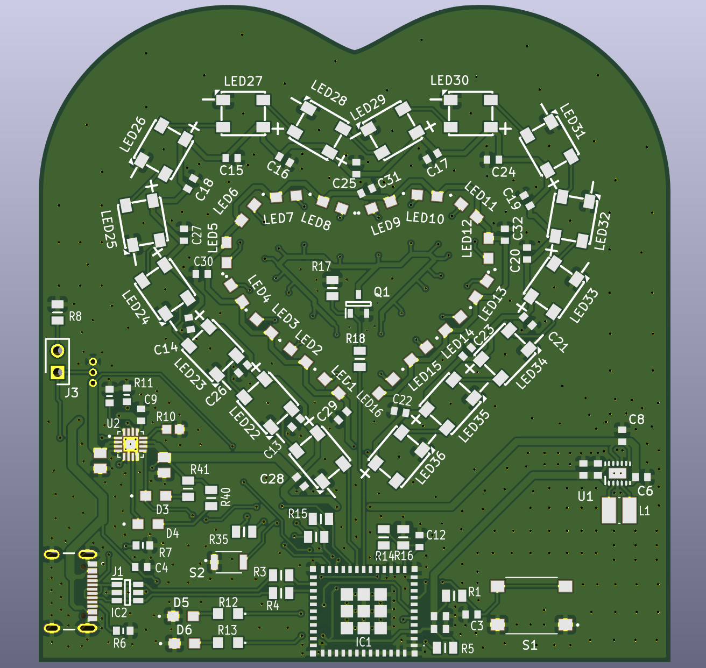
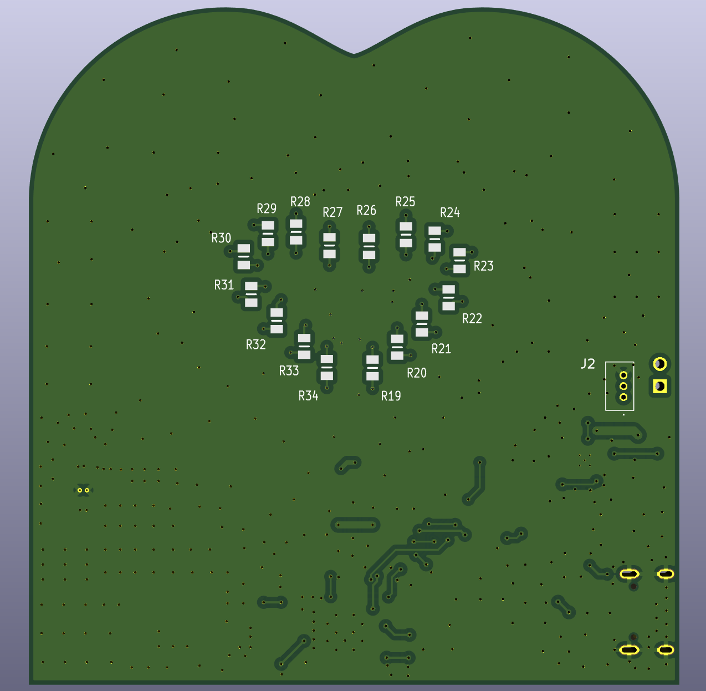
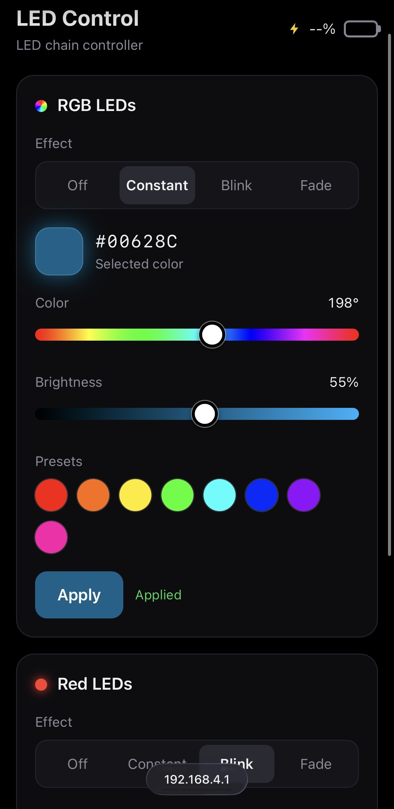
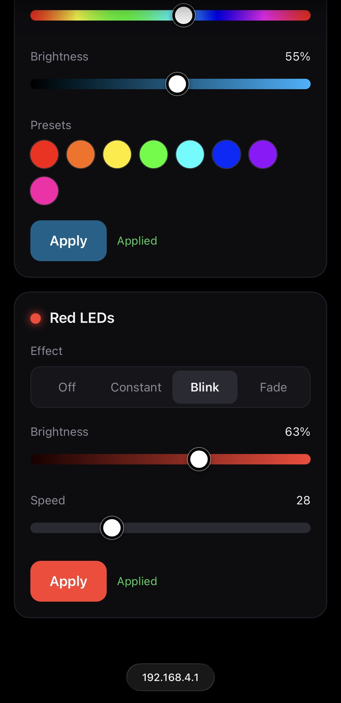

# PLED Firmware

Firmware for a custom ESP32-C3-MINI PCB with two heart-shaped LED chains, controlled from a web page on your phone. It works as an easy-to-configure night light at night and a nice decoration during the day.

## Dependencies

Built with [PlatformIO](https://platformio.org/) on the Arduino framework (`espressif32` platform).

| Library | Version | Used for |
|---|---|---|
| [FastLED](https://github.com/FastLED/FastLED) | 3.10.6 | Driving the WS2812B V6 RGB LEDs |
| [ArduinoJson](https://arduinojson.org/) | 7.x | Reading and writing the JSON sent between the page and the board |
| [WebSockets](https://github.com/Links2004/arduinoWebSockets) | 2.7.3 | Included for future live control (not used yet) |
| WiFi, WebServer, LittleFS | Arduino-ESP32 core | Wi-Fi access point, HTTP server, storing the web page |

PlatformIO installs these automatically from `platformio.ini`.

## The PCB

| Front | Back |
|---|---|
|  |  |

## What the firmware does

The board creates its own Wi-Fi network. Connect your phone to it, open `http://192.168.4.1`, and control both hearts from the page.

**LED chains**

- **RGB heart**: 16 WS2812B LEDs that can show any color.
- **Red heart**: 16 low-power red LEDs dimmed with PWM.

**What you can do from the page**

- **Choose an effect** for each chain: Off, Constant, Blink or Fade (breathing).
- **RGB heart**: pick a color with the color slider or a preset, and set its brightness.
- **Red heart**: set its brightness.
- **Set the speed** of Blink and Fade.
- **Press Apply** to send the settings to the board. Each chain has its own Apply button.

**What the board monitors**

- **Battery voltage**: shown on the page as a percentage, where 4.2 V is 100% and 3.3 V is 0%.
- **Charging state**: a ⚡ appears next to the battery while charging.
- **Wi-Fi status**: the Wi-Fi LED stays on when the network is ready and blinks while a phone is connected.

**Planned**

- Turn off Wi-Fi when the battery reaches 3.3 V, to protect it.

## The UI

| | |
|---|---|
|  |  |
